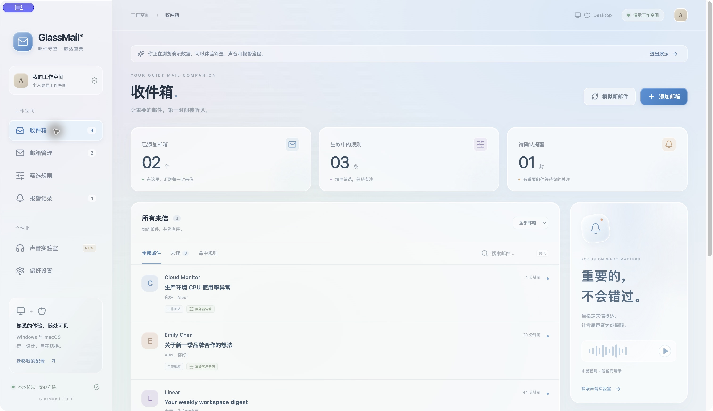

# GlassMail · 邮件守望

Windows + macOS 邮件监测桌面应用，采用统一的 Liquid Glass 风格：半透明面板、柔和光晕、玻璃高光、浅色与深色主题。使用 Electron + React，不依赖云端后端。



## 已实现

- 多个自定义收件邮箱：名称、地址、IMAP 主机、TLS 端口、授权码；支持连接测试、编辑、暂停、删除。
- 按收件邮箱、发件人完整地址或域名，以及主题/正文关键词筛选；支持 AND / OR，逗号分隔多个关键词。
- 每条规则分配独立声音：水晶轻响、风铃、脉冲、信标、自定义 MP3/WAV/OGG；可试听和调节音量，在「声音实验室」或「偏好设置」开启「循环播放」。
- 命中规则时播放声音、显示系统通知，并写入可确认的报警记录。
- 收件箱搜索、未读筛选、命中规则筛选、纯文本邮件阅读；点击单封邮件自动已读，收件箱右上角「全部已读」一键清除所有邮箱的本机未读状态。
- 托盘后台运行、手动同步、30–600 秒自动检查、暂停报警。Windows 窗口控制位于右上角；macOS 使用左上角的系统窗口按钮。顶部导航栏固定，只有下方页面内容滚动。
- Windows/macOS 配置导入导出；导出不包含授权码、邮件、报警记录和自定义音频。
- 与真实邮箱分开显示的演示工作空间，可模拟新邮件验证筛选和声音。

## 使用

1. 打开安装后的 GlassMail，在「邮箱管理」添加邮箱。
2. 在邮箱服务商中启用 IMAP，填写服务商提供的 IMAP 主机与授权码/应用专用密码。默认端口 993。
3. 点击「测试连接」，成功后「保存并连接」。
4. 在「筛选规则」选择收件邮箱、发件人/关键词、组合条件和音效。
5. 新邮件在下一次检查时触发提醒。可在「偏好设置」进入演示，提前试听体验。

「全部已读」作用于本机已接收的全部邮件，包括当前搜索或筛选之外的邮件，重启后保留；不修改邮箱服务器的已读状态，报警记录仍需单独确认。后续新邮件仍会显示为未读。

**首次连接与游标重置只载入最近 30 封邮件，不对历史邮件报警。** 后续每轮最多处理 100 封新邮件，剩余邮件在后续检查继续处理。当前设备最多保留 500 封邮件、300 条提醒。首轮历史邮件不会显示规则命中标签。

AND：发件人条件与每个关键词均需满足。OR：发件人或任一关键词匹配即可；所选收件邮箱范围始终生效。不区分关键词与邮箱地址大小写。域名精确匹配，不包括子域名。

多条规则同时命中时，合并成一条报警，使用规则列表中首条命中规则的声音。默认播放一次；开启「循环播放」后，报警与试听持续循环，内置音效每段间隔约半秒，自定义音频连续重播。点击顶部或声音实验室的「停止声音」、按 Esc、确认提醒或打开邮件均可停止。关闭循环开关、暂停报警、音量调至 0 或切换演示工作空间也会停止当前声音；后续新报警仍按当前设置播放。循环期间收到新报警会切换到新报警音，不叠加声音。循环开关重启后保留，并随配置导入导出；旧版配置默认关闭。暂停报警后继续收信与标记命中规则，但不播放声音、弹通知或生成新的报警记录。

## 多端迁移

在原设备「偏好设置 → 导出配置」，在另一台设备「导入配置」。导入前会显示邮箱与规则数量，并确认替换配置。导入会清空当前邮件缓存与报警记录、重建收信基线。

授权码通过操作系统加密能力保存在当前设备，不能通过配置文件迁移；相同 ID、主机、端口和邮箱的本机授权码会保留，否则需要重新填写。自定义音频需要重新导入，迁移配置中的自定义音效回退为「水晶轻响」。本版本不做云端自动同步。

## 从源码运行

建议使用 Node.js 24 LTS 和 npm。

```sh
cd /path/to/GlassMail
npm ci
npm start
```

只预览界面：`npm run dev`，访问 http://127.0.0.1:5173 。浏览器版不会连接 IMAP 或接收授权码。

```sh
npm test                 # 规则、配置迁移、收信游标与音效循环测试
npm run build            # 编译界面
npm run package:mac      # macOS arm64 / x64 的 DMG 与 ZIP
npm run package:win      # Windows x64 的 NSIS 安装程序
```

建议在对应操作系统打包，尤其是正式签名发布。`.github/workflows/build.yml` 在推送 `main` 分支、推送 `v*` 标签时自动构建，也可在 GitHub Actions 页面手动运行。工作流先运行测试，再分别生成 Windows 安装程序和 macOS 安装包；完成后从对应运行记录的 Artifacts 下载。工作流不会自动发布到公开 Release。

图标由仓库内 SVG 生成；需要修改时运行 `npm run icons`。现有 PNG 已包含在源码中，无需每次重建。

## 当前边界

- 支持隐式 TLS 的 IMAP 账号；目前不含 OAuth 登录与 STARTTLS。因此不支持只允许 OAuth 的组织邮箱。
- 实际提醒延迟取决于检查间隔、网络及邮件量；应用退出、设备睡眠/关机时不监测。不自动启动电脑或唤醒设备。
- 邮件超过 5 MB 时只获取发件人和主题，不下载正文，正文条件不会匹配这类邮件。附件不下载到磁盘，也不展示 HTML 邮件；小于限制的邮件通过 MIME 解析提取文本。
- 系统静音、音量和通知权限会影响声音/桌面通知。真实邮箱需由你填写授权码后验证，开发验证使用模拟 IMAP 客户端。
- 开发构建未做正式 Windows 代码签名和 Apple 公证；正式分发前需配置发行证书。macOS 本地开发包使用默认的临时签名机制，不使用个人开发证书。
- Windows 包可交叉生成，但本机为 macOS，未在真实 Windows 系统上运行验收。

## 数据与安全

数据位于 Electron 的 `userData` 目录：macOS 通常为 `~/Library/Application Support/GlassMail`，Windows 通常为 `%APPDATA%/GlassMail`。

`glassmail.json` 存放邮箱配置、规则、邮件缓存、报警与 UID 游标；授权码使用 Electron `safeStorage` 加密，不可用时拒绝保存。邮件正文及元数据为本机文件存储，未做整库加密；删除邮箱会移除关联缓存与规则。读取配置失败时保留原文件并停止启动，避免覆盖数据。

渲染窗口启用 `contextIsolation`、沙箱并关闭 Node 集成，只提供明确的 IPC 方法，校验请求窗口与主框架。邮件以 React 转义后的纯文本渲染，不加载邮件内链接、脚本或远程图片。IMAP 日志关闭；界面错误不展示授权码或服务端原始响应。

实现依据：[Electron 安全隔离](https://www.electronjs.org/docs/latest/tutorial/context-isolation)、[系统凭据加密](https://www.electronjs.org/docs/latest/api/safe-storage)、[ImapFlow 文档](https://imapflow.com/docs/)。
